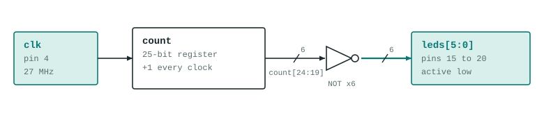
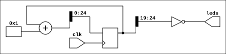

# blink

The smallest design in the repo: a free-running counter whose top six bits drive the six on-board LEDs. It exists to prove the toolchain, the pin file and the JTAG load all work.

## What it does

A 25-bit counter runs from the 27 MHz crystal. `count[24:19]` goes to the LEDs, inverted because they are active low. The result is a 6-bit binary count in which LED0 flickers too fast to follow, which looks like a shimmer.



The same design as Yosys draws it after synthesis (generated by `scripts/generate-diagrams.sh`):



## Files

| File | What |
|---|---|
| `blink.v` | Top module `blink` |
| `pins.cst` | `clk` on pin 4, LEDs on pins 15 to 20 |
| `apio.ini` | Board and top module for APIO |

## Build and load

```
source ../../env.sh
apio build
openFPGALoader -c ft2232 _build/default/hardware.fs     # to SRAM, gone on power cycle
```

## Status

Built and loaded on the board. Confirmed by eye: the LEDs show a fast binary count. No testbench.
