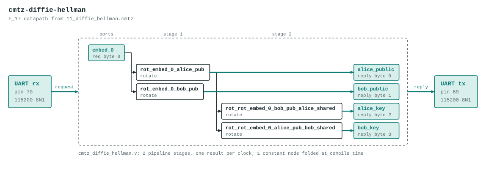

# cmtz-diffie-hellman

Toy Diffie-Hellman key exchange over F_17.

The datapath is generated by the Verilog backend of the Cook-Mertz compiler from `11_diffie_hellman.cmtz`:

```
-- 11_diffie_hellman.cmtz
--
-- Toy Diffie-Hellman key exchange over F_17.
--
-- Alice and Bob agree on a generator g = ω^0 = 1 (the embedded value).
-- Each picks a secret exponent and rotates:
--
-- Root table: g=3 generates F_17.
--   ω^5 = 5,  ω^11 = 7,  ω^16 = ω^0 = 1.
--
--   Alice: a = 5   →  g · ω^5 = 1 · 5 = 5
--   Bob:   b = 11  →  g · ω^11 = 1 · 7 = 7
--
-- They exchange public values and rotate again:
--
--   Alice computes Bob's public value rotated by her secret:
--     7 · ω^5 = 7 · 5 = 35 mod 17 = 1  (shared secret)
--
--   Bob computes Alice's public value rotated by his secret:
--     5 · ω^11 = 5 · 7 = 35 mod 17 = 1  (shared secret)
--
-- Both arrive at ω^(a+b) = ω^16 = 1.  The shared secret is the same
-- because rotation is commutative: ω^a · ω^b = ω^b · ω^a.
--
-- (In real DH the operation is exponentiation g^a, not multiplication
-- g·ω^a — this is a toy analogue showing the commutativity that makes
-- the protocol work.)

field(17, 19);
roots(17) as omega;

-- Generator: g = ω^0 = 1
embed(0, 0);

-- ── Alice's computation ──────────────────────────────────────────

-- Alice's secret: a = 5
-- Public value: g · ω^5 = 1 · 5 = 5
rotate(embed_0, alice_pub, 5);
measure(rot_embed_0_alice_pub, mod_p) as alice_public;   -- expect 5

-- ── Bob's computation ────────────────────────────────────────────

-- Bob's secret: b = 11
-- Public value: g · ω^11 = ω^11 = 7
rotate(embed_0, bob_pub, 11);
measure(rot_embed_0_bob_pub, mod_p) as bob_public;      -- expect 7

-- ── Key agreement ────────────────────────────────────────────────

-- Alice takes Bob's public (ω^11) and rotates by her secret (5):
-- ω^11 · ω^5 = ω^16 = 1
rotate(rot_embed_0_bob_pub, alice_shared, 5);
measure(rot_rot_embed_0_bob_pub_alice_shared, mod_p) as alice_key;  -- expect 1

-- Bob takes Alice's public (ω^5) and rotates by his secret (11):
-- ω^5 · ω^11 = ω^16 = 1
rotate(rot_embed_0_alice_pub, bob_shared, 11);
measure(rot_rot_embed_0_alice_pub_bob_shared, mod_p) as bob_key;    -- expect 1

-- alice_key == bob_key == 1  (shared secret)
```

The program's literal embeds are replaced by input ports, so the datapath computes the same graph for any values in 0 to 16 instead of the constants in the source. It has 2 pipeline stages, one result per clock, and no `%` operators: reductions are unrolled conditional subtracts.



## Ports

| Port | Bits | Carried as |
|---|---|---|
| `in_embed_0` | 5 | request byte 0 |
| `out_alice_public` | 5 | reply byte 0 |
| `out_bob_public` | 5 | reply byte 1 |
| `out_alice_key` | 5 | reply byte 2 |
| `out_bob_key` | 5 | reply byte 3 |

## UART protocol

115200 8N1 on the on-board USB bridge. Send 1 byte (each 0 to 16), read 4 bytes back. A complex port is two bytes, real part first. If any request byte is 17 or more, every reply byte is `0xFF`. If a request stalls partway for 250 ms, the bytes received so far are dropped. Bytes sent while a reply is going out are ignored, so read the whole reply before sending the next request.

Example: `03` replies `0F 04 03 03`.

LEDs (active low): `leds[4:0]` show the low bits of the first reply byte, `leds[5]` lights after an error reply.

## Files

| File | What |
|---|---|
| `cmtz_diffie_hellman_uart.v` | Top module `cmtz_diffie_hellman_uart`: UART receiver and transmitter and a control state machine around the datapath. Generated. |
| `cmtz_diffie_hellman.v` | The datapath. Generated. |
| `cmtz_diffie_hellman_tb.v` | Datapath testbench with 17 vectors, expected values from the compiler's Python reference. Generated. |
| `cmtz_diffie_hellman_uart_tb.v` | Whole-design testbench: bit-bangs the UART protocol for every vector, then checks the out-of-range reply and the resync timeout. Generated. |
| `pins.cst` | `clk` pin 4, `tx` pin 69, `rx` pin 70, LEDs pins 15 to 20 |
| `apio.ini` | Board and top module |

Regenerate with `examples/fpga/build_projects.py` in the Cook-Mertz repo rather than editing the generated files.

## Test

```
source ../../../env.sh
apio test        # prints PASS for both testbenches
```

## Status

Both testbenches pass in simulation and `apio build` succeeds. Checked on the board over the UART (96 vectors, all matching).
