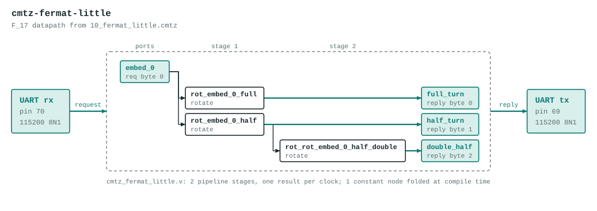

# cmtz-fermat-little

Fermat's little theorem as a rotation identity.

The datapath is generated by the Verilog backend of the Cook-Mertz compiler from `10_fermat_little.cmtz`:

```
-- 10_fermat_little.cmtz
--
-- Fermat's little theorem as a rotation identity.
--
-- In F_p, every non-zero element satisfies a^(p-1) ≡ 1 mod p.
-- In the Cook-Mertz model this is trivial: rotating a register by
-- m = p-1 steps is multiplication by ω^m = ω^(p-1) = 1.
--
-- Root table: g=3 generates F_17.
--   ω^5 = 3^5 mod 17 = 5,  ω^8 = 16 (= -1),  ω^16 = ω^0 = 1.
--
-- We embed ω^5 = 5 and rotate by m = 16.
-- Result: 5 · ω^16 = 5 · 1 = 5 (unchanged — Fermat's little theorem).
--
-- Half-turn: ω^8 = -1 mod 17.
-- So rotating by 8 negates: 5 · (-1) = -5 ≡ 12 mod 17.
-- Rotating by 8 again restores: 12 · (-1) = -12 ≡ 5 mod 17.

field(17, 19);
roots(17) as omega;

embed(0, 5);                -- a = ω^5 = 5

-- Full turn: rotate by m = p-1 = 16  →  must return to original value
rotate(embed_0, full, 16);
measure(rot_embed_0_full, mod_p) as full_turn;          -- expect 5

-- Half turn: rotate by m/2 = 8  →  negation
rotate(embed_0, half, 8);
measure(rot_embed_0_half, mod_p) as half_turn;          -- expect 12

-- Double half turn: two negations cancel
rotate(rot_embed_0_half, double, 8);
measure(rot_rot_embed_0_half_double, mod_p) as double_half;  -- expect 5
```

The program's literal embeds are replaced by input ports, so the datapath computes the same graph for any values in 0 to 16 instead of the constants in the source. It has 2 pipeline stages, one result per clock, and no `%` operators: reductions are unrolled conditional subtracts.



## Ports

| Port | Bits | Carried as |
|---|---|---|
| `in_embed_0` | 5 | request byte 0 |
| `out_full_turn` | 5 | reply byte 0 |
| `out_half_turn` | 5 | reply byte 1 |
| `out_double_half` | 5 | reply byte 2 |

## UART protocol

115200 8N1 on the on-board USB bridge. Send 1 byte (each 0 to 16), read 3 bytes back. A complex port is two bytes, real part first. If any request byte is 17 or more, every reply byte is `0xFF`. If a request stalls partway for 250 ms, the bytes received so far are dropped. Bytes sent while a reply is going out are ignored, so read the whole reply before sending the next request.

Example: `03` replies `03 0E 03`.

LEDs (active low): `leds[4:0]` show the low bits of the first reply byte, `leds[5]` lights after an error reply.

## Files

| File | What |
|---|---|
| `cmtz_fermat_little_uart.v` | Top module `cmtz_fermat_little_uart`: UART receiver and transmitter and a control state machine around the datapath. Generated. |
| `cmtz_fermat_little.v` | The datapath. Generated. |
| `cmtz_fermat_little_tb.v` | Datapath testbench with 17 vectors, expected values from the compiler's Python reference. Generated. |
| `cmtz_fermat_little_uart_tb.v` | Whole-design testbench: bit-bangs the UART protocol for every vector, then checks the out-of-range reply and the resync timeout. Generated. |
| `pins.cst` | `clk` pin 4, `tx` pin 69, `rx` pin 70, LEDs pins 15 to 20 |
| `apio.ini` | Board and top module |

Regenerate with `examples/fpga/build_projects.py` in the Cook-Mertz repo rather than editing the generated files.

## Test

```
source ../../../env.sh
apio test        # prints PASS for both testbenches
```

## Status

Both testbenches pass in simulation and `apio build` succeeds. Checked on the board over the UART (96 vectors, all matching).
