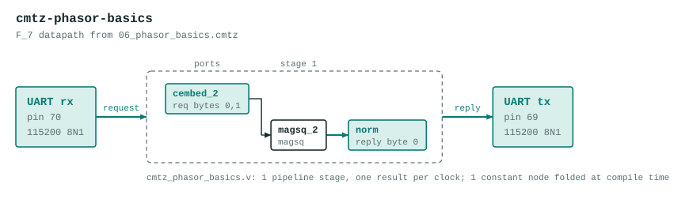

# cmtz-phasor-basics

v4 phasor network: complex F_{p²} arithmetic.

The datapath is generated by the Verilog backend of the Cook-Mertz compiler from `06_phasor_basics.cmtz`:

```
-- 06_phasor_basics.cmtz
--
-- v4 phasor network: complex F_{p²} arithmetic.
--
-- cfield(p) declares a complex extension field F_{p²} = F_p[i]/(i²-c),
-- where c is the smallest quadratic non-residue mod p (auto-computed).
--
-- For p=7: g=3, c=3 (since 3^3=27≡-1 mod 7), q=53 (nextprime(48)).
-- Root table (m = p-1 = 6):  ω^0=1  ω^1=3  ω^2=2  ω^3=6  ω^4=4  ω^5=5
--
-- DSL operations in F_{7²}:
--
--   cembed(re_psi, im_psi)  → register holds  ω^re_psi + i·ω^im_psi
--   conj(z) as name         → a+bi  →  a-bi mod p
--   magsq(z) as name        → a²-b²·c  mod p  (type-lowers F_{p²}→F_p)
--   add(a, b) as name       → component-wise addition
--
-- Concrete values:
--   cembed_1 = ω^0 + i·ω^0 = 1 + i       (1, 1)
--   cembed_2 = ω^1 + i·ω^2 = 3 + 2i      (3, 2)
--   conj_2   = 3 - 2i                    (3, 5)   (-2 ≡ 5 mod 7)
--   magsq_2  = 3²-2²·3 = 9-12 = -3 ≡ 4  (mod 7)
--   sum_12   = (1+3) + (1+2)i = 4 + 3i   (4, 3)

cfield(7);              -- F_7,  c=3 (auto),  q=53 (auto)

cembed(0, 0);           -- cembed_1 = 1 + 1i
cembed(1, 2);           -- cembed_2 = 3 + 2i

conj(cembed_2) as conj_2;            -- 3 + 5i  (-2 ≡ 5 mod 7)
magsq(cembed_2) as magsq_2;          -- 4 mod 7

add(cembed_1, cembed_2) as sum_12;   -- (4, 3) = 4 + 3i

-- magsq type-lowers F_{7²} → F_7, so measure with mod_p
measure(magsq_2, mod_p) as norm;     -- expect 4
```

The program's literal embeds are replaced by input ports, so the datapath computes the same graph for any values in 0 to 6 instead of the constants in the source. It has 1 pipeline stage, one result per clock, and no `%` operators: reductions are unrolled conditional subtracts.



## Ports

| Port | Bits | Carried as |
|---|---|---|
| `in_cembed_2` | 6 | request byte 0 and 1 (re, im) |
| `out_norm` | 3 | reply byte 0 |

## UART protocol

115200 8N1 on the on-board USB bridge. Send 2 bytes (each 0 to 6), read 1 byte back. A complex port is two bytes, real part first. If any request byte is 7 or more, every reply byte is `0xFF`. If a request stalls partway for 250 ms, the bytes received so far are dropped. Bytes sent while a reply is going out are ignored, so read the whole reply before sending the next request.

Example: `00 03` replies `01`.

LEDs (active low): `leds[4:0]` show the low bits of the first reply byte, `leds[5]` lights after an error reply.

## Files

| File | What |
|---|---|
| `cmtz_phasor_basics_uart.v` | Top module `cmtz_phasor_basics_uart`: UART receiver and transmitter and a control state machine around the datapath. Generated. |
| `cmtz_phasor_basics.v` | The datapath. Generated. |
| `cmtz_phasor_basics_tb.v` | Datapath testbench with 49 vectors, expected values from the compiler's Python reference. Generated. |
| `cmtz_phasor_basics_uart_tb.v` | Whole-design testbench: bit-bangs the UART protocol for every vector, then checks the out-of-range reply and the resync timeout. Generated. |
| `pins.cst` | `clk` pin 4, `tx` pin 69, `rx` pin 70, LEDs pins 15 to 20 |
| `apio.ini` | Board and top module |

Regenerate with `examples/fpga/build_projects.py` in the Cook-Mertz repo rather than editing the generated files.

## Build flag

`apio.ini` sets `yosys-extra-options = -noalu`. With yosys's default ALU mapping this design gave wrong answers on the chip (most vectors mismatched) although RTL and post-synthesis simulation pass; with `-noalu` every vector matched. The cause inside the toolchain is not isolated. The price is up to twice the LUTs. A project only gets the default ALU mapping once it has been checked on the board with it.

## Test

```
source ../../../env.sh
apio test        # prints PASS for both testbenches
```

## Status

Both testbenches pass in simulation and `apio build` succeeds. Checked on the board over the UART (96 vectors, all matching) with the flag above.
