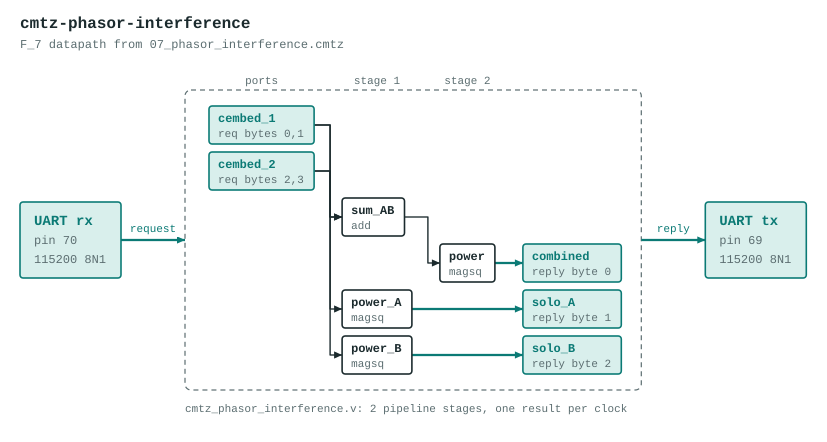

# cmtz-phasor-interference

Two-phasor interference in F_{7²}.

The datapath is generated by the Verilog backend of the Cook-Mertz compiler from `07_phasor_interference.cmtz`:

```
-- 07_phasor_interference.cmtz
--
-- Two-phasor interference in F_{7²}.
--
-- Two signals are embedded as complex elements of F_{p²} = F_7[i]/(i²-c)
-- where c = find_nonresidue(7) = 3.  Primitive root g = 3 in F_7, so:
--
--   Signal A = ω^0 + i·ω^1 = 1 + 3i
--   Signal B = ω^2 + i·ω^0 = 2 + 1i
--
-- Superposition:  A + B = (1+2, 3+1) = (3, 4) mod 7
-- Conjugate of A: conj(A) = (1, -3) = (1, 4) mod 7
--
-- Power of the sum:
--   |A+B|² = a² - b²·c mod p
--          = 3² - 4²·3 mod 7
--          = 9 - 48 mod 7
--          = 9 - 48 = -39 ≡ 3 mod 7
--
-- This is destructive interference: the combined power (3) is less
-- than the sum of individual powers would be in ordinary arithmetic,
-- because the cross-term phases partially cancel in F_{p²}.

cfield(7);

-- Two phasor sources at different phase angles
cembed(0, 1);       -- cembed_1: A = ω^0 + i·ω^1 = (1, 3)
cembed(2, 0);       -- cembed_2: B = ω^2 + i·ω^0 = (2, 1)

-- Superposition: vector sum in F_{7²}
add(cembed_1, cembed_2) as sum_AB;      -- (3, 4)

-- Conjugate of the first signal
conj(cembed_1) as A_bar;               -- (1, 4)

-- Power of the superposition: type-lowers F_{7²} → F_7
magsq(sum_AB) as power;                -- 3² - 4²·3 = 3 mod 7

-- Also measure individual power for comparison
magsq(cembed_1) as power_A;            -- 1² - 3²·3 = 1 - 27 = -26 ≡ 2 mod 7
magsq(cembed_2) as power_B;            -- 2² - 1²·3 = 4 - 3 = 1 mod 7

-- Read out the scalar results (now in F_7, not F_{7²})
measure(power, mod_p) as combined;      -- expect 3
measure(power_A, mod_p) as solo_A;      -- expect 2
measure(power_B, mod_p) as solo_B;      -- expect 1
```

The program's literal embeds are replaced by input ports, so the datapath computes the same graph for any values in 0 to 6 instead of the constants in the source. It has 2 pipeline stages, one result per clock, and no `%` operators: reductions are unrolled conditional subtracts.



## Ports

| Port | Bits | Carried as |
|---|---|---|
| `in_cembed_1` | 6 | request byte 0 and 1 (re, im) |
| `in_cembed_2` | 6 | request byte 2 and 3 (re, im) |
| `out_combined` | 3 | reply byte 0 |
| `out_solo_A` | 3 | reply byte 1 |
| `out_solo_B` | 3 | reply byte 2 |

## UART protocol

115200 8N1 on the on-board USB bridge. Send 4 bytes (each 0 to 6), read 3 bytes back. A complex port is two bytes, real part first. If any request byte is 7 or more, every reply byte is `0xFF`. If a request stalls partway for 250 ms, the bytes received so far are dropped. Bytes sent while a reply is going out are ignored, so read the whole reply before sending the next request.

Example: `00 02 04 03` replies `04 02 03`.

LEDs (active low): `leds[4:0]` show the low bits of the first reply byte, `leds[5]` lights after an error reply.

## Files

| File | What |
|---|---|
| `cmtz_phasor_interference_uart.v` | Top module `cmtz_phasor_interference_uart`: UART receiver and transmitter and a control state machine around the datapath. Generated. |
| `cmtz_phasor_interference.v` | The datapath. Generated. |
| `cmtz_phasor_interference_tb.v` | Datapath testbench with 66 vectors, expected values from the compiler's Python reference. Generated. |
| `cmtz_phasor_interference_uart_tb.v` | Whole-design testbench: bit-bangs the UART protocol for every vector, then checks the out-of-range reply and the resync timeout. Generated. |
| `pins.cst` | `clk` pin 4, `tx` pin 69, `rx` pin 70, LEDs pins 15 to 20 |
| `apio.ini` | Board and top module |

Regenerate with `examples/fpga/build_projects.py` in the Cook-Mertz repo rather than editing the generated files.

## Build flag

`apio.ini` sets `yosys-extra-options = -noalu`. With yosys's default ALU mapping this design gave wrong answers on the chip (most vectors mismatched) although RTL and post-synthesis simulation pass; with `-noalu` every vector matched. The cause inside the toolchain is not isolated. The price is up to twice the LUTs. A project only gets the default ALU mapping once it has been checked on the board with it.

## Test

```
source ../../../env.sh
apio test        # prints PASS for both testbenches
```

## Status

Both testbenches pass in simulation and `apio build` succeeds. Checked on the board over the UART (96 vectors, all matching) with the flag above.
