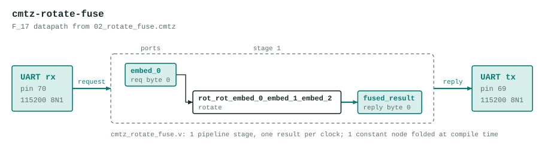

# cmtz-rotate-fuse

Rotation fusion: two consecutive ω-gates collapse into one.

The datapath is generated by the Verilog backend of the Cook-Mertz compiler from `02_rotate_fuse.cmtz`:

```
-- 02_rotate_fuse.cmtz
--
-- Rotation fusion: two consecutive ω-gates collapse into one.
-- The optimizer's fuse_rotations pass detects that:
--   rotate(src, _, j=5) followed by rotate(prev, _, j=3)
-- can be replaced by a single rotate(src, _, j=8), saving one
-- modular multiply.
--
-- Math: ω^5 · ω^3 = ω^(5+3) = ω^8 = 16 mod 17  (= -1 mod 17)
-- After fusion: rotations_fused stat should be 1.

field(17, 19);
roots(17) as omega17;

embed(0, 0);                             -- r0 ← ω^0 = 1

-- First gate: multiply by ω^5
-- creates register rot_embed_0_embed_1 = ω^5 = 14
rotate(embed_0, embed_1, 5);

-- Second gate: multiply by ω^3
-- src = previous IRRotate node → fusion condition satisfied
-- Before fusion: rot_rot_embed_0_embed_1_embed_2 = ω^8 = 16
-- After  fusion: same register, but IRRotate.j patched from 3 → 8
rotate(rot_embed_0_embed_1, embed_2, 3);

-- Measure the doubly-rotated result.
-- Value: ω^0 * ω^5 * ω^3 = ω^8 = 16 mod 17
measure(rot_rot_embed_0_embed_1_embed_2, mod_p) as fused_result;
```

The program's literal embeds are replaced by input ports, so the datapath computes the same graph for any values in 0 to 16 instead of the constants in the source. It has 1 pipeline stage, one result per clock, and no `%` operators: reductions are unrolled conditional subtracts.



## Ports

| Port | Bits | Carried as |
|---|---|---|
| `in_embed_0` | 5 | request byte 0 |
| `out_fused_result` | 5 | reply byte 0 |

## UART protocol

115200 8N1 on the on-board USB bridge. Send 1 byte (each 0 to 16), read 1 byte back. A complex port is two bytes, real part first. If any request byte is 17 or more, every reply byte is `0xFF`. If a request stalls partway for 250 ms, the bytes received so far are dropped. Bytes sent while a reply is going out are ignored, so read the whole reply before sending the next request.

Example: `03` replies `0E`.

LEDs (active low): `leds[4:0]` show the low bits of the first reply byte, `leds[5]` lights after an error reply.

## Files

| File | What |
|---|---|
| `cmtz_rotate_fuse_uart.v` | Top module `cmtz_rotate_fuse_uart`: UART receiver and transmitter and a control state machine around the datapath. Generated. |
| `cmtz_rotate_fuse.v` | The datapath. Generated. |
| `cmtz_rotate_fuse_tb.v` | Datapath testbench with 17 vectors, expected values from the compiler's Python reference. Generated. |
| `cmtz_rotate_fuse_uart_tb.v` | Whole-design testbench: bit-bangs the UART protocol for every vector, then checks the out-of-range reply and the resync timeout. Generated. |
| `pins.cst` | `clk` pin 4, `tx` pin 69, `rx` pin 70, LEDs pins 15 to 20 |
| `apio.ini` | Board and top module |

Regenerate with `examples/fpga/build_projects.py` in the Cook-Mertz repo rather than editing the generated files.

## Test

```
source ../../../env.sh
apio test        # prints PASS for both testbenches
```

## Status

Both testbenches pass in simulation and `apio build` succeeds. Checked on the board over the UART (96 vectors, all matching).
