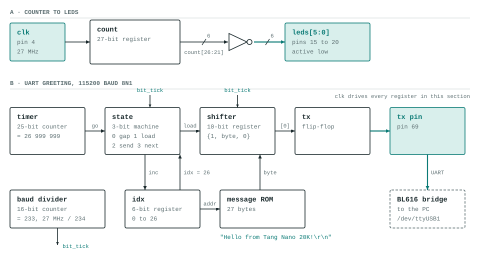

# hello

A UART transmitter that sends `Hello from Tang Nano 20K!` once a second, plus a slow binary count on the LEDs. It uses the on-board BL616 as the USB-serial bridge, so the greeting shows up on the PC with no extra hardware.

## What it does

- A one-second timer starts a small state machine.
- The state machine reads the 27 message bytes from a ROM, one at a time, into a 10-bit shift register (`{stop 1, byte, start 0}`).
- A baud divider (27 MHz ÷ 234) clocks the register out at 115200 baud, 8N1, through a flip-flop to pin 69.
- The LEDs show `count[26:21]`, inverted: a binary count that repeats about every 5 seconds.

## Files

| File | What |
|---|---|
| `hello.v` | Top module `hello` |
| `pins.cst` | `clk` pin 4, `tx` pin 69, LEDs pins 15 to 20 |
| `apio.ini` | Board and top module for APIO |

## Build, load, listen

```
source ../../env.sh
apio build
openFPGALoader -c ft2232 _build/default/hardware.fs     # to SRAM, gone on power cycle
```

Then read the board's UART at 115200 baud: `/dev/serial/by-id/usb-SIPEED_USB_Debugger_*-if01-port0`. A snippet that does this with only the Python standard library is in [`developing.md`](../../developing.md).

## Block diagram



## Status

Built and loaded on the board. The greeting was read from the serial port once a second, and the LEDs counted. No testbench.
