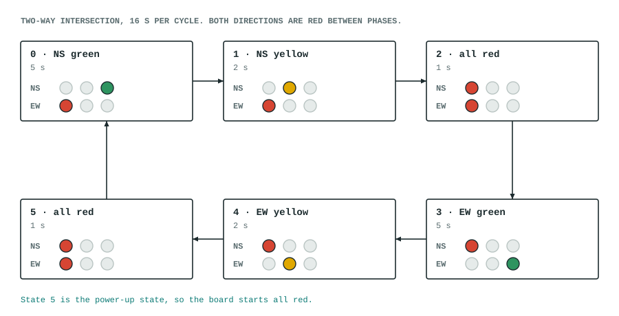

# stoplight

A two-way intersection on the six on-board LEDs, written as a small state machine with a self-checking testbench.

## What it does

Six states cycle forever. Both directions are red between phases, so green never overlaps.

| State | North–south | East–west | Seconds |
|---|---|---|---|
| 0 NS green | green | red | 5 |
| 1 NS yellow | yellow | red | 2 |
| 2 all red | red | red | 1 |
| 3 EW green | red | green | 5 |
| 4 EW yellow | red | yellow | 2 |
| 5 all red | red | red | 1 |

One full cycle is 16 seconds. State 5 is also the power-up state, so the board starts all red.



## Lamps and pins

| Lamp | LED | Pin |
|---|---|---|
| NS red | LED0 | 15 |
| NS yellow | LED1 | 16 |
| NS green | LED2 | 17 |
| EW red | LED3 | 18 |
| EW yellow | LED4 | 19 |
| EW green | LED5 | 20 |

The LEDs are active low, so the module inverts the lamp pattern on the way out. The clock is on pin 4.

## How it is built

Three registers, each in its own `always` block: `ticks` counts clocks to make a second, `secs` counts seconds in the current phase, and `state` holds the phase. When `secs` reaches the phase's length minus one at the end of a second, `state` advances and `secs` restarts. The one-register-per-block structure follows [a comment on the Hackaday series](../../docs/hackaday-fpga-chronicles.md) about keeping unrelated logic out of one `if` chain.

The module takes `CLK_HZ`, `GREEN_S`, `YELLOW_S` and `ALLRED_S` as parameters, so the testbench can run at 10 Hz and still check the real structure.

## Files

| File | What |
|---|---|
| `stoplight.v` | Top module `stoplight` |
| `stoplight_tb.v` | Testbench; prints `PASS` or `FAIL` |
| `pins.cst` | `clk` pin 4, LEDs pins 15 to 20 |
| `apio.ini` | Board and top module for APIO |

## Test, build, load

```
source ../../env.sh
apio test                                                # runs stoplight_tb.v
apio build
openFPGALoader -c ft2232 _build/default/hardware.fs      # to SRAM, gone on power cycle
```

## Status

- The testbench passes: it checks that the lamp patterns change in the expected order, for the expected time, over 23 changes, and that the two directions are never green or yellow together.
- A copy with a 3-second yellow fails the testbench, so the checks do catch a real mistake.
- Built and loaded on the board; the lamps step through the cycle as described.
- It uses 61 LUT4s and 43 flip-flops.
